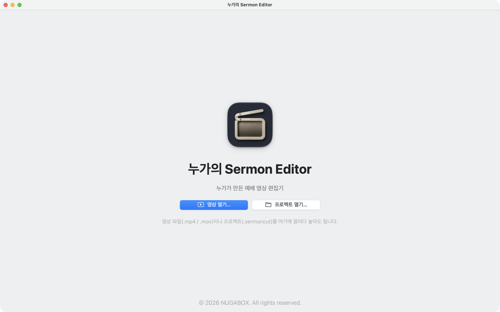
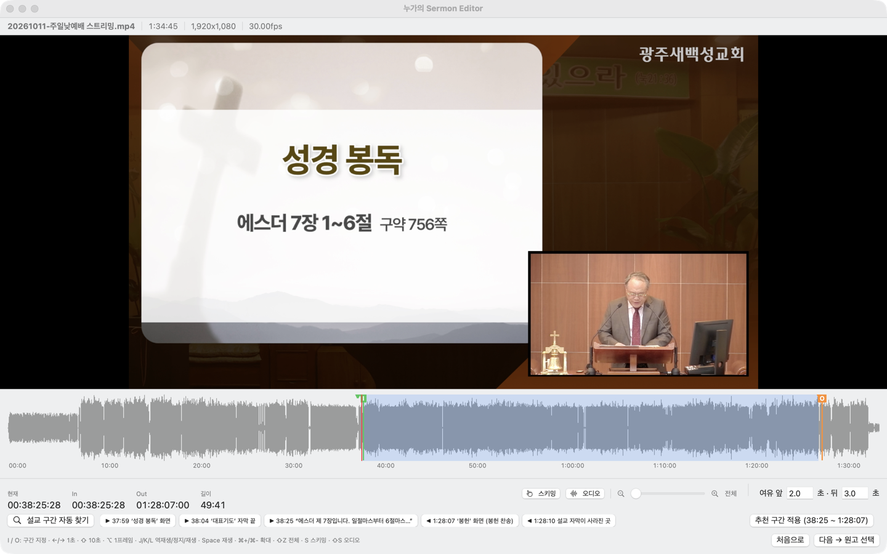
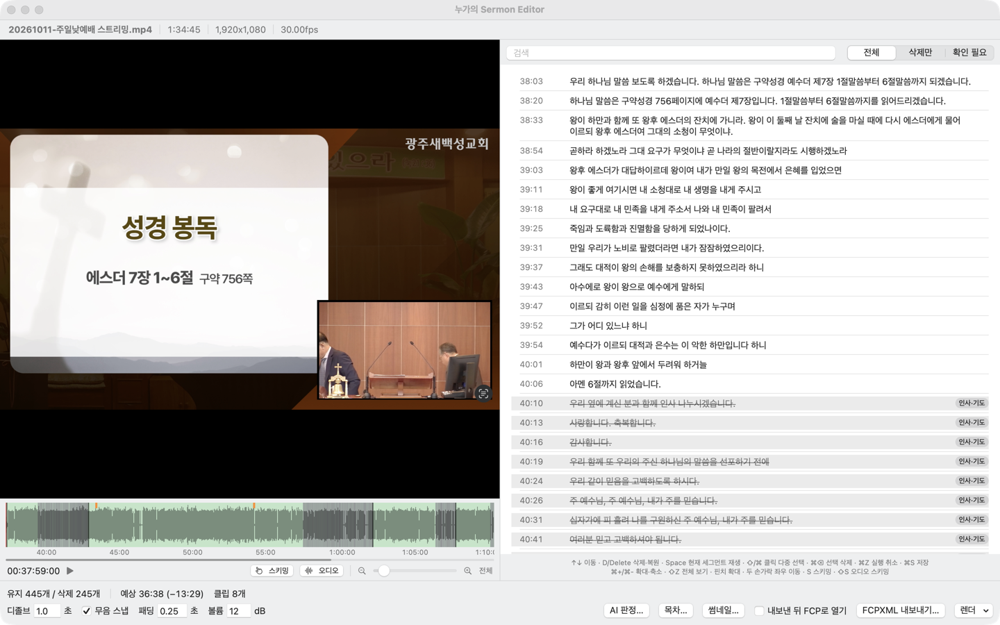

# 누가의 Sermon Editor

> 예배 실황 영상에서 설교만 골라내고, 원고와 맞지 않는 이야기(광고·근황·시사 등)를 덜어낸 편집본을 Final Cut Pro 프로젝트(FCPXML)나 MP4로 만들어 주는 macOS 앱

## 주요 기능

| 기능 | 설명 |
|---|---|
| 설교 구간 자동 찾기 | 화면 자막 OCR과 빠른 음성 인식으로 설교 시작·끝 후보 제시 |
| 원고 대조 | 음성 전사(whisper large-v3)와 원고(.hwp, .hwpx, .docx, .txt) 문장을 맞춰 원고 밖 구간 표시 |
| AI 탈선 판정 | 원고 밖 구간이 설교 부연인지, 광고·근황·시사 같은 탈선인지 판정 (DeepSeek · Claude · OpenAI 호환) |
| 자연스러운 편집점 | 말과 말 사이 쉼 안에서 자르고 1초 디졸브로 연결 |
| 타임라인 | 확대·축소(⌘+ / ⌘- / 핀치), 스키밍(S), 오디오 스키밍(⇧S) — Final Cut Pro와 같은 단축키 |
| 설교 목차 | 유튜브 챕터용 목차를 원고 소제목·화면 자막에서 자동 생성 |
| 썸네일 | 원고 제목·본문으로 유튜브 썸네일 자동 생성 (배경은 템플릿으로 교체) |
| 내보내기 | Final Cut Pro용 FCPXML(인트로·아웃트로·챕터 포함), 프리뷰·최종 MP4 렌더 |

원본 영상은 읽기만 하고 수정하지 않습니다. AI 판정 결과도 확인한 뒤에만 반영됩니다.

## 스크린샷







## 이용 방법

### 설치

Apple Silicon(M1 이상) Mac, macOS 14 이상.

1. [Releases](https://github.com/nugaBox/sermon-editor/releases)에서 `SermonEditor-<버전>.dmg`를 내려받아 열고, 앱을 **Applications**로 끌어다 놓습니다.
2. DMG 안의 **필수 구성요소 설치.command**를 더블클릭합니다. [Homebrew](https://brew.sh)로 ffmpeg·whisper-cpp를 설치하고 음성 인식 모델(약 3.2GB)을 내려받습니다.
3. 처음 열 때 "Apple이 확인할 수 없음"이 나오면 **시스템 설정 → 개인정보 보호 및 보안 → [그래도 열기]**.
4. AI 판정을 쓰려면 **설정(⌘,)** 에서 API 키를 넣습니다. 키는 키체인에만 저장됩니다.
5. 썸네일·인트로/아웃트로 템플릿은 쓰던 Mac의 `~/Library/Application Support/SermonCut/templates` 폴더를 같은 위치로 복사합니다.

### 빌드

```bash
scripts/build-app.sh release --install   # /Applications에 설치
scripts/make-dmg.sh                      # 배포용 DMG → build/
swift test                               # 단위 테스트
```

© 2026 NUGABOX. All rights reserved.
